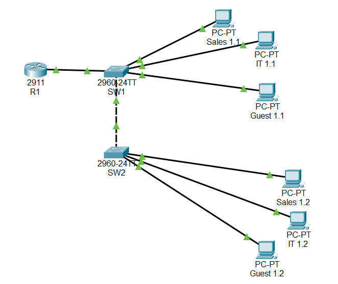
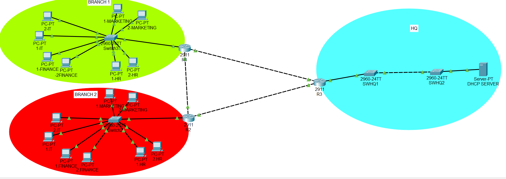
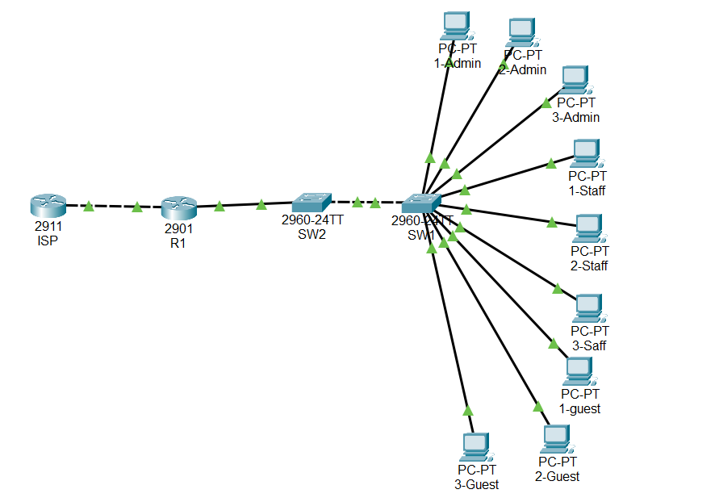

# Networking Labs

Hands-on Cisco networking labs built in Cisco Packet Tracer.

## About me
CCNA-certified, with a bachelor's degree in IT. Interested in networking and cybersecurity.

## Labs

### 01 - Small Office Network

- Subnetting: 192.168.10.0/24 split into three /26 subnets
- VLANs: Sales (10), IT (20), Guest (30)
- Trunk and access ports
- Inter-VLAN routing (Router-on-a-Stick)
- DHCP pools on the router
- Spanning Tree: SW1 configured as root bridge
- ACL: Guest VLAN blocked from reaching the IT VLAN

## Tools
Cisco Packet Tracer

### 02 - Multi-Site Enterprise Network (HQ + 2 Branches)

- Three sites: HQ and two branches, connected by routers
- VLANs per department (IT, Marketing, HR, Finance)
- Trunk links between switches and routers
- Router sub-interfaces for Inter-VLAN routing
- OSPF with redundant paths: traffic fails over to the alternate route if a link goes down
- Centralized DHCP server at HQ, with ip helper-address (DHCP relay) on the branch routers
- Management IPs on all routers and switches
- Remote access secured with SSH

- ## Tools
Cisco Packet Tracer

### 03 - Secure Branch Network

- Single branch with three departments: Admin, Staff, Guest
- VLANs (10, 20, 30) with a trunk link between the two switches
- Router-on-a-Stick for Inter-VLAN routing
- NAT/PAT for internet access
- Centralized DHCP server at the ISP, with ip helper-address (DHCP relay) on the branch router
- ACLs: Guest limited to internet only, Staff blocked from Admin
- Port Security on access ports: sticky MAC, shutdown on violation
- DHCP Snooping with trusted trunk/uplink ports and rate limiting on access ports
- Remote access secured with SSH, login banner, and encrypted passwords

- - ## Tools
Cisco Packet Tracer

